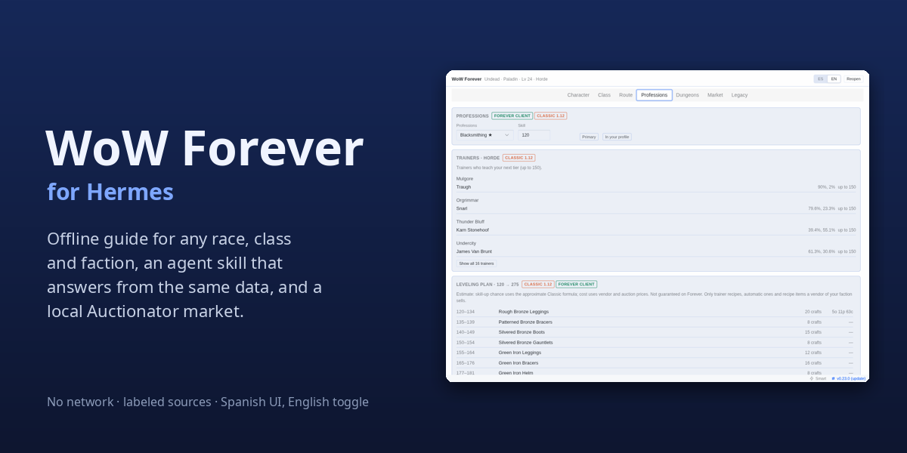

# WoW Forever para Hermes

[English](README.md)



Guía offline de **World of Warcraft: Forever** dentro de Hermes, para cualquier raza, clase y
facción, con una skill para que tu agente responda con los mismos datos.

## Estado

- Versión 2.0.0. La 1.0.0 solo cubría tres clases (Cazador, Guerrero y Chamán).
- Todavía no está en el catálogo de plugins de Hermes. Probado en Linux con Hermes Agent
  v0.23.0, que es la versión mínima.
- WoW Forever es el juego oficial de Blizzard (producto `wowf`, cliente 1.60), no un servidor
  privado. Este proyecto no tiene afiliación con Blizzard.

## Instalación

```sh
hermes plugins install Grizaceo/wow-forever --ref <commit de 40 caracteres>
hermes plugins enable wow-forever
```

En Hermes Desktop, abre **Capabilities → Plugins**, busca **WoW Forever** y enciéndela: la
página llega apagada aunque el plugin esté habilitado. Aparece en la barra lateral. La skill
`wow-forever:wow-forever` funciona en cualquier superficie de Hermes.

**Si vienes de la 1.0.0:** corre `hermes plugins update wow-forever`. Hermes Desktop carga la
página nueva tras **Rescan** en **Capabilities → Plugins** («Volver a buscar» si Hermes está
en español), o al reiniciarse. La página conserva el id interno de la 1.0.0, así que se
mantienen el encendido o apagado, el progreso de la guía, los precios, su historial y el
permiso de carpeta. La ruta pasa de `/wow-hunter-guide` a `/wow-forever`.

## Qué hace

- **Personaje**: facción, raza (las 10, Skyborne incluida), clase (las 9 en ambas facciones),
  nivel y profesiones. Marca las combinaciones nuevas de Forever, como Paladín no-muerto o
  Chamán enano.
- **Clase**: entrenadores de tu facción con coordenadas, hechizos por nivel, misiones de clase,
  y las armas y armaduras que puedes usar.
- **Ruta**: zonas para tu nivel con las misiones de tu facción, más las bandas de la guía curada
  si tu clase tiene una.
- **Profesiones**: recetas con su dificultad, reactivos y cómo se aprenden; costo y margen con
  tus precios; plan de subida; de dónde sale cada material, y los entrenadores del siguiente
  tramo.
- **Dungeons**: jefes en orden con su botín, filtro de lo que tu clase puede usar, y los 9
  dungeons nuevos de Forever con sus jefes.
- **Mercado**: importa tu `Auctionator.lua`, la contabilidad TSM y el diario del puente
  WoWForeverBridge; acumula el historial, marca ofertas y recomienda dónde farmear.
- **Guía curada** del Cazador de la Horda y **Legacy**. Un test las compara con los datos generados
  (ítems, botín, misiones, hechizos, razas); las demás clases usan solo los datos generados.
- **Skill del agente**: responde preguntas como «soy Paladín no-muerto nivel 24, ¿dónde
  entreno?» o «¿qué subo de herrería con 120 de skill?» consultando los datos del plugin. El
  botón **Copiar perfil para el agente** de la pestaña Personaje le pasa tu personaje al chat.

La interfaz está en español, con un botón para inglés, en tema claro u oscuro. Cada dato dice si
viene de WoW Classic 1.12 (aproximado para Forever), del cliente de Forever o de la guía
curada. Lo que no está en ninguna fuente publicable se muestra como **sin datos**.

### Fuentes de precios

El mercado se alimenta de tres fuentes locales, todas leídas como datos (nunca ejecutadas)
desde la carpeta SavedVariables que concedes una vez:

**Auctionator** — precios anunciados.

1. En el juego, haz un **full scan** con Auctionator.
2. Escribe `/reload` o vuelve a entrar, para que el juego guarde los datos.
3. En la guía, ve a **Mercado** → **Leer Auctionator.lua**. La primera vez, Hermes abre su
   selector de carpetas: elige `WTF/Account/<tu cuenta>/SavedVariables`. Hermes recuerda ese
   permiso, y puedes revocarlo en **Capabilities → Plugins → Folder access** (Capacidades →
   Plugins → Acceso a carpetas, con Hermes en español). Si la carpeta que concediste antes no
   tiene el archivo, la guía abre el selector; **Elegir otra carpeta** lo abre cuando quieras.
   También puedes importar el archivo a mano con **Importar archivo .lua**.

Cada importación suma sus días al historial de cada ítem, aunque Auctionator solo guarde unas
tres semanas.

**Contabilidad TSM** — tus ventas, compras, expiraciones y cancelaciones personales
(`TradeSkillMaster.lua`, campos `csvSales/csvBuys/csvExpired/csvCancelled`). Cada lectura
válida reemplaza el snapshot completo (TSM modifica filas acumulativas); son operaciones
ejecutadas, no precios anunciados, y se mantienen separadas del mercado Auctionator. Ver
**Mercado → Mis ventas**.

**Diario WoWForeverBridge** — el addon compañero (`WoWForeverBridge` v1.0.1, SavedVariables
`WoWForeverBridgeDB`) captura cada escaneo de Auctionator en un diario por día
(`WoWForeverBridge.lua`) que sobrevive la poda de ~21 días del propio Auctionator. La
retención se configura en el juego con `/wfb days N`. El puente es un transporte, no un
exportador verificado: los precios que trae se etiquetan con procedencia **UNKNOWN** por diseño.

**Sondeo automático** — las tres fuentes se sondean cada 30 s mientras Hermes esté abierto y
el plugin habilitado, aunque Mercado no esté montado. Concede la carpeta SavedVariables una
vez; el sondeo nunca abre un selector en segundo plano y espera si falta o se revocó el permiso.

### Preguntar a DAVI

En **Personaje**, **Profesiones** y **Mercado** hay un botón **Preguntar a DAVI**. Abre un panel
con tu pregunta (editable) y una vista previa del contexto que se adjuntará: solo lo elegido en
esa pestaña. Dos conmutadores dejan fuera el **perfil** o los **precios**; la vista previa cambia
al momento y se **congela** al abrir, así que editar la pregunta o la selección no la altera.

- **Personaje**: facción, raza, clase, nivel y profesiones del perfil cargado a mano.
- **Profesiones**: la profesión y su skill; si hay una receta seleccionada, esa receta y **solo
  sus reactivos** (acotados), con costo y margen si hay precios de subasta.
- **Mercado**: solo con un ítem de detalle abierto; trae el último mínimo anunciado, la oferta
  máxima diaria observada, el día observado y la fecha de importación. **No** incluye el
  historial completo ni el archivo `Auctionator.lua`.

El texto siempre aclara que el perfil es **cargado a mano, no el juego en vivo**; que los precios
son **ofertas anunciadas, no ventas**; y que la referencia de botín/farmeo es **Classic 1.12, no
verificada en Forever**.

Al confirmar, el plugin inserta el texto en el chat activo con
`host.composer.insertText(null, texto, { mode: 'block' })`. **Nunca** envía la pregunta por sí
solo ni toca el borrador (`submit`/`setDraft`). Si no se puede insertar, lo copia al portapapeles;
si eso falla, el texto queda seleccionable para copia manual. Con éxito confirmado, el botón se
deshabilita para no insertar dos veces, y no se escribe nada nuevo en el almacenamiento.

## Qué lee, qué guarda y qué ejecuta

- **Lee** únicamente `Auctionator.lua`, `TradeSkillMaster.lua` y `WoWForeverBridge.lua` dentro
  de la carpeta que concedes con el selector de Hermes (búsqueda acotada de subcarpetas), y
  sus propios `data/`. Cada archivo se interpreta como datos: nunca se ejecuta Lua.
- **Guarda** tu perfil, el progreso de la guía y los precios normalizados en el almacenamiento
  propio del plugin, en tu máquina. Precios e historial usan el almacén v2 (`market-v2-*`,
  `price-history-v2-*`); los datos v1 previos a la migración se conservan en un respaldo
  `pre-v2-backup` troceado (partes ≤3 MiB + manifiesto, bajo el tope de 4 MiB por archivo del
  host) para poder volver atrás. Puedes borrarlos desde la app.
- **Sin red**: la página bloquea toda conexión (`connect-src 'none'`). No hay telemetría.
- **Sin procesos** ni acceso al juego en ejecución. La página no lanza nada.
- **La skill** no registra herramientas. Trae un script de Python de solo lectura,
  `skills/wow-forever/scripts/consultar.py`, que el agente corre con su propia terminal (bajo
  las aprobaciones de Hermes). Solo usa la biblioteca estándar, solo lee `data/` del plugin, no
  escribe archivos y no usa red.

## Cómo funciona

```
tools/fuentes.json ── tools/descargar-fuentes.py ──▶ ~/.cache/wow-forever-drops
   (versiones y sha256 fijados)                         │
                         tools/build-drop-data.py ◀──────┤──▶ tools/build-datos-juego.py
                                   │                                 │
                         standalone/drop-data.js                    data/*.json ──▶ skills/wow-forever/scripts/consultar.py
                                   │                                 │
                                   │                 tools/build-catalogo-mercado.py
                                   │                                 │
                                   │                  standalone/market-catalog.js
                                   └───────────────┬─────────────────┘
                        desktop/src/ (React + SDK) ── desktop/build.mjs ──▶ desktop/plugin.js

standalone/guide-*.js (curado) ── tools/build-referencias-skill.mjs ──▶ skills/wow-forever/references/*.md
```

- Las fuentes de datos están fijadas por versión y sha256 en `tools/fuentes.json`: CMaNGOS
  classic-db (commit `28ef625`), y las tablas del cliente Classic Era 1.15.9.70576 y del
  cliente WoW Forever 1.60.1.70888 (en inglés y español), vía wago.tools. El detalle está en
  `docs/MODELO-DATOS.md`.
- Los generadores son deterministas: con las mismas entradas producen los mismos bytes, y un
  test lo comprueba contra `data/MANIFEST.json`.
- La mitad de escritorio son componentes React del SDK de Hermes (`desktop/src/`), empaquetados
  sin minificar por esbuild en un solo `desktop/plugin.js`. `desktop/BUNDLE.json` guarda su
  sha256, y un test lo reconstruye y lo compara. Solo importa `@hermes/plugin-sdk` y React.
  Ver `docs/DESKTOP.md` y `docs/ARQUITECTURA.md` (capas y grafo de dependencias).
- La página conserva el id interno de la versión anterior (`wow-hunter-guide`): Hermes guarda
  datos y permisos por id, así que el progreso, los precios y el permiso de carpeta se
  mantienen.
- La skill y la página comparten los datos y las reglas. Un test compara la dificultad de cada
  receta en el script de Python y en la lógica de la página.

Tests:

```sh
node scripts/run-gates.mjs                 # TODOS los gates canónicos en un comando; reporta conteos esperados
# Individualmente:
python3 -m unittest discover -s tests     # datos, lint de Hermes, bundle reproducible, skill (87)
node --test tests/                         # lógica pura: perfil, crafteo, mercado, ruta, guía, referencias (261)
lua5.1 addon/tests/test_bridge.lua         # diario del puente (52)
PLAYWRIGHT_MODULE=… CHROMIUM_PATH=… node desktop/test/navegador.mjs   # + 9 suites (307 total)
```

El stack canónico, los conteos esperados y el harness legado de `standalone/tests/` (excluido
del runner porque su «real fixture» lee SavedVariables vivos) están en `docs/TESTING.md`.

## Cómo se hizo

El mantenedor decidió el alcance, las fuentes de datos admitidas y qué se publica, y revisa cada
rama antes de fusionarla. El código lo escribieron agentes de IA (Claude Code y Devin) bajo esa
dirección. Lo verificado en cada paso queda en los tests del repo. No se verificó dentro del
juego: macros, rutas y estimaciones de oro por hora.

## Límites

- Los datos de 1.12 (misiones, entrenadores, botín, spawns) son una referencia: Forever cambió
  zonas, ítems y botín. El contenido nuevo de Forever que solo existe en el servidor no tiene
  todavía una fuente que se pueda publicar, y la guía lo muestra como **sin datos**. Eso
  incluye misiones nuevas, entrenadores de Paladín de la Horda y Chamán de la Alianza, la zona
  de inicio Skyborne, el botín de los dungeons nuevos y cómo se aprenden casi todas las
  recetas nuevas.
- Forever movió algunos mapas: las coordenadas de 1.12 en Mulgore, Eastern Plaguelands,
  Redridge y Stormwind pueden no coincidir con el juego.
- Oro por hora, ROI y ofertas son estimaciones sobre precios anunciados, no ventas.
- Las macros y rutas curadas no se probaron en el juego. Solo el Cazador de la Horda tiene guía
  curada: las de Guerrero y Chamán nombraban ítems, jefes y razas que no existen y se retiraron
  hasta reescribirlas.
- Algunos ítems clásicos no traen nombre en español en el cliente esMX y se muestran en inglés.

## Licencia

GPL-3.0-or-later (`LICENSE`). Origen y licencia de cada dataset en `LICENSE-DATA.md`. World of
Warcraft y sus nombres son marcas de Blizzard Entertainment. Proyecto sin afiliación con
Blizzard y de uso no comercial.
