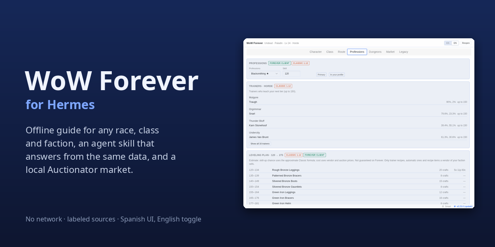

# WoW Forever for Hermes

[Español](README.es.md)



An offline guide to **World of Warcraft: Forever** inside Hermes, for any race, class and
faction, with a skill so your agent answers from the same data.

## Status

- Version 2.4.0 adds farming for gold: a session plan scored by the gold you actually keep per
  hour (the full value of each kill, a sell cap per item, real camps), and the companion
  WoWForeverFarm addon to measure your sessions in-game, not yet verified on the Forever
  client.
- Version 2.2.1 removes world-event spawns from the drop data: Ahn'Qiraj war, invasions,
  holidays, Darkmoon Faire and the Fishing Extravaganza. The farm ranking no longer counts
  mobs that only appear during an event as permanent ones.
- Version 2.2.0 adds a descriptive summary of personal TSM auction sales, with explicit
  evidence limits and no implicit Auctionator comparison. Tested with synthetic fixtures,
  not validated against a live player account. English is the default UI, Spanish optional. The
  market shows each item's thumbnail, tied to its item id. Version 2.0.0 added the local
  market, professions planner and the agent skill; 1.0.0 covered three classes only (Hunter,
  Warrior and Shaman).
- Submitted to the Hermes plugin catalog as `wow-forever`; once it is listed,
  `hermes plugins search wow-forever` finds it. Tested on Linux with Hermes Agent v0.23.0,
  which is the minimum version.
- WoW Forever is Blizzard's official game (product `wowf`, client 1.60), not a private
  server. This project is not affiliated with Blizzard.

## Stability and contributor checks

- [Reproducible CI and local setup](docs/CI.md) (Linux, macOS, Windows).
- [Addon sync troubleshooting](docs/SYNC-TROUBLESHOOTING.md).
- [Tab performance measurements](docs/PERFORMANCE-TAB-SWITCH.md).
- [Generalization roadmap](docs/GENERALIZATION-ROADMAP.md) (Spanish): current
  coverage is not the same as equally deep guidance for every character.

## Install

```sh
hermes plugins install wow-forever
hermes plugins enable wow-forever
```

The first command installs the catalog entry, at the commit the catalog reviewed. Until the
entry is listed, or to follow this repository directly, install from GitHub instead:

```sh
hermes plugins install Grizaceo/wow-forever
```

Add `--ref <40-character commit>` to pin a commit. Versions before 2.1.1 carried invisible
characters in a doc that made Hermes's install scanner stop a direct Git install until it got
`--force`; 2.1.1 removes them.

In Hermes Desktop, open **Capabilities → Plugins**, find **WoW Forever** and switch it on: the
page arrives switched off even when the plugin is enabled. It then shows up in the sidebar. The
`wow-forever:wow-forever` skill works on every Hermes surface.

**Private repository:** your GitHub account needs access and authenticated Git (for example,
`gh auth login`). Direct Git installs do not require catalog approval. For updates run
`hermes plugins update wow-forever`; installs pinned with `--ref <40-character commit>`
stay pinned and must be explicitly reinstalled at the desired commit. Catalog installs,
when available, follow the catalog-reviewed commit instead of the latest branch head.

**Upgrading from 1.0.0:** run `hermes plugins update wow-forever`. Hermes Desktop loads the new
page after **Rescan** in **Capabilities → Plugins**, or when it restarts. The page keeps the
1.0.0 internal id, so your on/off choice, guide progress, prices, price history and folder
grant carry over. The route changes from `/wow-hunter-guide` to `/wow-forever`.

## What it does

- **Character**: faction, race (all 10, Skyborne included), class (all 9 in both factions),
  level and professions. It marks the combinations that are new in Forever, such as Undead
  Paladin or Dwarf Shaman.
- **Class**: your faction's trainers with coordinates, spells by level, class quests, and the
  weapons and armor you can use.
- **Route**: zones for your level with your faction's quests, plus the curated guide's level
  bands when your class has one.
- **Professions**: recipes with their difficulty, reagents and how they are learned; cost and
  margin with your prices; a leveling plan; where each material comes from; and the trainers
  for your next tier.
- **Dungeons**: bosses in order with their loot, a filter for what your class can use, and the
  9 new Forever dungeons with their bosses.
- **Market**: imports your `Auctionator.lua`, TSM accounting and the WoWForeverBridge daily
  diary; builds up price history, flags deals and shows each item's thumbnail from its item id.
- **Farming for gold**: a session plan that maximizes the gold you actually end up with per hour
  (real camps, kills/h from mob health and spawn spacing, the full value of each kill, a sell cap
  from your own TSM sales or the posted supply), the best camps, and the sessions you measure
  in-game with the companion **WoWForeverFarm** addon (time, combat, looting, kills and loot per
  mob), compared against the prediction and used to calibrate the plan to how you play.
- **Curated guide** for the Horde Hunter, and **Legacy**. A test checks them against the generated
  data (items, loot, quests, spells, races); the other classes use the generated data only.
- **Agent skill**: answers questions such as "I'm a level 24 Undead Paladin, where do I
  train?" or "what do I craft at 120 Blacksmithing?" by querying the plugin's data. The
  **Copy profile for the agent** button on the Character tab hands your character to the chat.

The interface is in English by default, with a button for Spanish, in light or dark theme. Every piece of
data says whether it comes from WoW Classic 1.12 (approximate for Forever), from the Forever
client or from the curated guide. Whatever no publishable source covers is shown as **no
data**.

### Price sources

The market feeds on three local sources, all read as data (never executed) from the
SavedVariables folder you grant once:

**Auctionator** — asking prices.

1. In the game, run a **full scan** with Auctionator.
2. Type `/reload` or log out and back in, so the game saves the data.
3. In the guide, go to **Market** → **Read Auctionator.lua**. The first time, Hermes opens its
   folder picker: choose `WTF/Account/<your account>/SavedVariables`. Hermes remembers that
   grant, and you can revoke it under **Capabilities → Plugins → Folder access**. If the
   folder you granted earlier does not contain the file, the guide opens the picker; **Pick
   another folder** opens it at any time. You can also import the file by hand with
   **Import .lua file**.

Each import adds its days to every item's history, even though Auctionator keeps only about
three weeks.

**TSM accounting** — your personal sales, buys, expirations and cancellations
(`TradeSkillMaster.lua`, fields `csvSales/csvBuys/csvExpired/csvCancelled`). Each valid read
replaces the whole snapshot (TSM mutates cumulative rows); these are executed operations, not
asking prices, and are kept separate from the Auctionator market. See **Market → My sales**.

**WoWForeverBridge diary** — the companion addon (`WoWForeverBridge` v1.0.1, SavedVariables
`WoWForeverBridgeDB`) captures every Auctionator scan into a daily journal
(`WoWForeverBridge.lua`) that survives Auctionator's own ~21-day prune. Retention is
configurable in-game with `/wfb days N`. The bridge is a transport, not a verified exporter:
prices it carries are labelled **UNKNOWN** provenance by design.

**WoWForeverFarm sessions** — a second companion addon (`addon/WoWForeverFarm`, SavedVariables
`WoWForeverFarmDB`, its own small `WoWForeverFarm.lua`) counts a farming session in-game:
`/wff start`, `/wff stop`, then `/reload`. Market → Farming reads it from the same granted
folder and writes an aggregate summary, `farmeo-agente.json`, into the plugin data folder for
the skill's `consultar.py farmeo-*` commands. It is **not yet verified on the Forever client**:
see `addon/WoWForeverFarm/VERIFICAR.md`. Design: `docs/FARMEO-ORO.md`.

**Automatic polling** — all three sources are polled every 30 s while Hermes is open and the
plugin enabled, even when Market is not mounted. Grant the SavedVariables folder once; the
poll never opens a picker in the background and waits if the grant is missing or revoked.

**Pawn scales (optional)** — `Pawn.lua` is outside the three files declared above. The guide
opens it only after you tick **Read Pawn.lua (scale catalog)** on the Pawn tab; it also needs
the same folder grant. The choice is stored as a revocable preference, and without it the tab
shows only the catalog already saved. Nothing else is read from that file.

### Item thumbnails

Market rows show a thumbnail next to each item name, selected by the item id in
`data/items.json`. The image is a single WebP sprite bundled at build time from Blizzard's
item icons; the plugin never downloads images at runtime. Items without a known icon leave the
space blank rather than showing a made-up picture.

### Ask the agent

The **Ask the agent** button on the **Character**, **Professions** and **Market** tabs opens a panel
with your question (editable) and a preview of the context that will be attached: only what you
picked on that tab. Two toggles drop the **profile** or the **prices**; the preview updates right
away and is **frozen** when the panel opens, so editing the question or the selection does not
change it.

- **Character**: faction, race, class, level and professions from the hand-entered profile.
- **Professions**: the profession and its skill; if a recipe is selected, that recipe and **only
  its reagents** (bounded), with cost and margin when auction prices exist.
- **Market**: only with a detail item open; it carries the last posted minimum, the observed
  peak daily supply, the observed day and the import date. It does **not** include the full
  history or the `Auctionator.lua` file.

The text always states that the profile is **hand-entered, not the live game**; that prices are
**posted offers, not sales**; and that loot/farming reference is **Classic 1.12, not verified in
Forever**.

On confirm, the plugin inserts the text into the active chat with
`host.composer.insertText(null, text, { mode: 'block' })`. It **never** sends the question by
itself and never touches the draft (`submit`/`setDraft`). If it cannot insert, it copies to the
clipboard; if that fails, the text stays selectable for manual copy. Once a confirm succeeds the
button is disabled so it cannot insert twice, and nothing new is written to storage.

## What it reads, stores and runs

- **Reads** only `Auctionator.lua`, `TradeSkillMaster.lua`, `WoWForeverBridge.lua` and
  `WoWForeverFarm.lua` inside the folder you grant with the Hermes picker (bounded subfolder search), and its own `data/`.
  Every file is parsed as data: Lua is never run.
- **Stores** your profile, guide progress and normalized prices in the plugin's own storage on
  your machine. Prices and history use the v2 store (`market-v2-*`, `price-history-v2-*`); the
  pre-migration v1 data is kept in a chunked `pre-v2-backup` (≤3 MiB parts + manifest, under
  the host's 4 MiB per-file cap) so you can roll back. You can delete them from the app.
- **No network**: the page blocks every connection (`connect-src 'none'`). No telemetry.
- **No processes** and no access to the running game. The page launches nothing.
- **The skill** registers no tools. It ships a read-only Python script,
  `skills/wow-forever/scripts/consultar.py`, that the agent runs with its own terminal (under
  Hermes approvals). It uses the standard library only, reads only the plugin's `data/`, writes
  no files and uses no network.

## How it works

```
tools/fuentes.json ── tools/descargar-fuentes.py ──▶ ~/.cache/wow-forever-drops
   (pinned versions and sha256)                         │
                         tools/build-drop-data.py ◀──────┤──▶ tools/build-datos-juego.py
                                   │                                 │
                         standalone/drop-data.js                    data/*.json ──▶ skills/wow-forever/scripts/consultar.py
                                   └───────────────┬─────────────────┘
                        desktop/src/ (React + SDK) ── desktop/build.mjs ──▶ desktop/plugin.js

standalone/guide-*.js (curated) ── tools/build-referencias-skill.mjs ──▶ skills/wow-forever/references/*.md
```

- Data sources are pinned by version and sha256 in `tools/fuentes.json`: CMaNGOS classic-db
  (commit `28ef625`), and the client tables of Classic Era 1.15.9.70576 and WoW Forever
  1.60.1.70888 (English and Spanish), through wago.tools. Details are in
  `docs/MODELO-DATOS.md`.
- The generators are deterministic: the same inputs give the same bytes, and a test checks
  that against `data/MANIFEST.json`.
- The desktop half is React components on the Hermes SDK (`desktop/src/`), bundled unminified
  by esbuild into a single `desktop/plugin.js`. `desktop/BUNDLE.json` records its sha256, and a
  test rebuilds and compares it. It imports only `@hermes/plugin-sdk` and React. See
  `docs/DESKTOP.md` and `docs/ARQUITECTURA.md` (layers and dependency graph).
- The page keeps the previous version's internal id (`wow-hunter-guide`): Hermes stores data
  and grants per id, so progress, prices and the folder grant carry over.
- The skill and the page share the data and the rules. A test compares every recipe's
  difficulty in the Python script and in the page's logic.

Tests:

```sh
node scripts/run-gates.mjs                 # ALL canonical gates in one command; reports expected counts
# Individually:
python3 -m unittest discover -s tests     # data, Hermes lint, reproducible bundle, skill (86)
node --test tests/                         # pure logic: profile, crafting, market, route, guide, references (324)
lua5.1 addon/tests/test_bridge.lua         # bridge diary (95)
PLAYWRIGHT_MODULE=… CHROMIUM_PATH=… node desktop/test/navegador.mjs   # + 12 suites (349 total)
```

The canonical stack and expected counts are in `docs/TESTING.md`; one command runs all
gates: `node scripts/run-gates.mjs`.

## How this was built

The maintainer decided the scope, which data sources are allowed and what gets published, and
reviews every branch before merging it. AI agents (Claude Code and Devin) wrote the code under
that direction. What each step verified is in the repository's tests. Not verified in the
game: macros, routes and gold-per-hour estimates.

## Limits

- The 1.12 data (quests, trainers, loot, spawns) is a reference: Forever changed zones, items
  and loot. New Forever content that exists only on the server has no publishable source yet,
  and the guide shows it as **no data**. That includes new quests, Horde Paladin and Alliance
  Shaman trainers, the Skyborne starting zone, loot from the new dungeons and how most new
  recipes are learned.
- Forever moved some maps: the 1.12 coordinates in Mulgore, Eastern Plaguelands, Redridge and
  Stormwind may not match the game.
- Gold per hour, ROI and deals are estimates over listed prices, not sales.
- The curated macros and routes were not tested in the game. Only the Horde Hunter has a curated
  guide: the Warrior and Shaman ones named items, bosses and races that do not exist and were
  withdrawn until they are rewritten.
- Some classic items have no Spanish name in the esMX client and show in English.

## License

GPL-3.0-or-later (`LICENSE`). The origin and license of each dataset are in `LICENSE-DATA.md`.
World of Warcraft and its names are trademarks of Blizzard Entertainment. This project is not
affiliated with Blizzard and is non-commercial.
